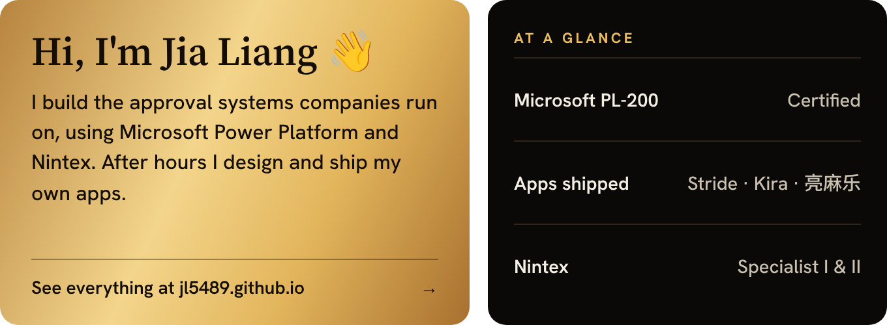

<table>
<tr><td width="36%"></td><td><h3><a href="https://jl5489.github.io/#stride-title">Stride</a></h3>Android  A free running and cycling app. Every run turns into a 3D flyover video you can post to your stories.</td></tr>
<tr><td></td><td><h3><a href="https://jl5489.github.io/#kira-title">Kira 记啦</a></h3>Android · PWA  An ad-free money manager. Payments from Malaysian bank apps and e-wallets wait for you to confirm.</td></tr>
<tr><td></td><td><h3><a href="https://jl5489.github.io/#mj-title">亮麻乐</a></h3>Web  Cantonese mahjong in a phone browser. Share a six-digit room code; bots take the empty seats.</td></tr>
</table>

<a href="https://www.linkedin.com/in/jia-liang-teoh-23020a2a4/">LinkedIn</a> · <a href="https://jl5489.github.io/">jl5489.github.io</a>

